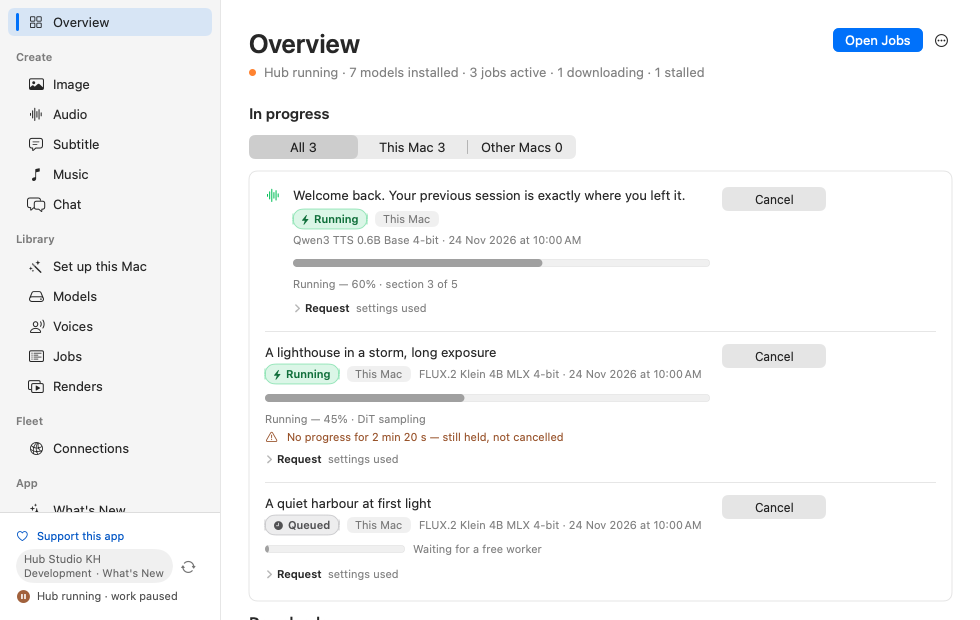
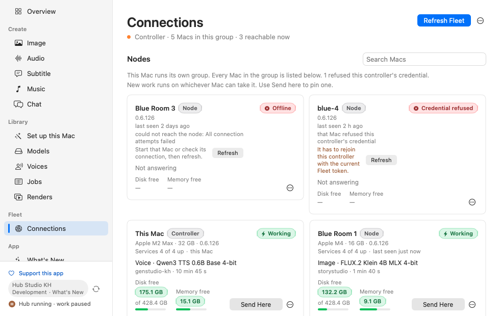

# Hub Studio KH

Independent native macOS application project for local creation on Apple Silicon. Existing Pinokio installations and their maintenance flow remain untouched.

**Current handoff:** read the [new-computer guide](docs/NEW-COMPUTER-HANDOFF.md),
[bug/fix backlog](qualification/bug-audit-2026-09-20.md), and
[task board](docs/tasks/BOARD.md). Earlier verification is in the
[2026-09-20 takeover evidence](qualification/takeover-2026-09-20.md). The installed
version observed during takeover is 0.6.38. The 0.4.0 instructions below are historical;
unfinished Music work is preserved separately on `codex/recovered-music-draft`.

Music recovery has since advanced beyond that preserved draft: its reviewed package/engine
contract is integrated, and the bounded runtime/staging/supervision continuation is tracked in
[the Music recovery card](docs/tasks/MUSIC-RECOVERY.md). Music is not yet exposed in the native
workflow and no real Music model inference is claimed.

## What it looks like





Also in `docs/screenshots/`: [the overview in dark mode](docs/screenshots/overview-dark.png) and [Connections in dark mode](docs/screenshots/connections-dark.png). Both screens were captured from this build with demo content, not from a live machine.

## Current direction — 2026-09-15

The focused release is **Hub + Image Studio + Voice Studio + Subtitle Studio**.
Its models are FLUX.2 Klein 4B MLX 4-bit; Qwen3 TTS Base 0.6B/1.7B;
VoxCPM2 4-bit/8-bit/full; OmniVoice full; and three Whisper choices.
Music is an accepted extension with its backend/runtime integrated; its native workflow
and real-model qualification remain open. Chat and Video are deferred.

All operating defaults are editable. Generated-output cleanup defaults to **20 GB
of live output per device across the studios and 7 days after generation**, whichever
condition is reached first; cleaned-up work moves to a Trash Folder that hands itself
to macOS Trash after **7 days or 20 GB**, and a 5 GB free-disk floor applies.
The Trash Folder can also hold old outputs that were never collected (unacknowledged for over
7 days), so the owner's permanent delete from the Gateway can destroy undelivered work; the
Gateway marks them as kind "output". That delete is guarded against API-key and browser callers
(it needs the owner's app window and a confirmed count and size); it does not stop code already
running as the owner on that Mac, and a fleet-token holder can reach the Hub's trash routes directly. Automatic login startup and optional scoped-token
connection to GatewayKH are part of the target. The app bundles runtimes; complete
model packages can accompany it in an offline install kit.

The model-package foundation supports configured GitHub/original-host downloads and copy/paste
of complete model folders, with the same companion-file validation. Address/IP, port
and token connections retain the existing external-client API boundary. GatewayKH
is the current client; exact adapter compatibility is tracked under R09, not assumed.

Compatibility targets original M1 and newer with macOS 14 Sonoma as the oldest current
MLX baseline, rather than requiring the newest macOS. Exact point-release/model support
still needs physical qualification. See the design's compatibility and OS-update rules.

Read the [design and flows](docs/standalone-plan.md), [build order](docs/implementation-plan.md)
and [agent task board](docs/tasks/BOARD.md). The board separates implemented foundations
from remaining app integration.

## Historical implementation and build notes

The remainder of this README records earlier artifacts and milestones. Its old
build/install commands and model qualification statements are historical. For current
setup, use [the new-computer handoff](docs/NEW-COMPUTER-HANDOFF.md) and its audit backlog.
Do not use an old versioned app path below as the current release identity.

## ST-01 foundation

The [runtime/model contract](docs/runtime-contract.md) now includes ten immutable model
manifests, verified HTTPS downloads, offline folder import and refresh without duplicate
copies. Complete files and companions must match their hashes before registration.
Separate Image and Voice runtime inputs are pinned; Subtitle reuses the Voice runtime
in a later independent process.

[Phase evidence](qualification/st01.md) records the real Whisper Turbo import and
relocated-library check, small-file HTTPS smoke, tests and runtime limitations.
ST-02 connects these helpers to the packaged Hub. ST-03 packages FLUX. Image runtime
relocation and physical M1/Sonoma model tests remain explicit later checkpoints.
Both missing [Whisper Base and Small packages](qualification/whisper-stock-2026-09-15.md)
are now downloaded and fully file-verified; transcription qualification is separate.

## 0.4.0 development build

The native shell connects to a bundled Hub, which owns the private Voice process.
The Hub exposes authenticated jobs, model import/download/verification and editable
device policy settings. Worker death stops the owner so the shell can show a failed
service instead of leaving a stale healthy connection. Automatic login startup and bounded
recovery are implemented and integrated (ST-09); physical login/logout/reboot acceptance
remains ST-11, and start-at-login is source/fixture-qualified only — no live registration
has been performed.

This is an intermediate build. The narrowed model-specific controls, independent
Subtitle process and generated-output cleanup enforcement are still on the task board.
The existing native CustomVoice form is unavailable for the approved Qwen Base packages
until their dedicated workflow is implemented. File verification alone never qualifies
a model/runtime for generation.

## Existing 0.3.0 preview

The native SwiftUI/AppKit preview packages Voice only. Historical
[redesign evidence](qualification/native-redesign.md) proves Qwen 0.6B **CustomVoice**
generation and Whisper Turbo transcription/SRT export. It does not prove the requested
Qwen Base models. Hub and Image engines are not bundled. The preview's six navigation
destinations reflect the older plan, not six implemented engines.

That existing artifact is preserved. The following commands build the current source
into a separate development artifact.

## Native build

Build the local artifact on an Apple Silicon Mac:

```sh
bash native/build.sh
python3 -B packaging/stage_voice.py --runtime .build/voice-runtime --native-shell .build/StudioHub --output 'dist/Studio Hub 0.4.0 Local Proof.app'
```

Both native scripts default to `macosx26.5`: the installed SDK 27 toolchain lacks
the SwiftUI macros plugin needed here. Select another installed SDK explicitly
with `STUDIOHUB_MACOS_SDK=<xcrun-sdk-selector>`; an empty/unavailable selection
fails before compilation and never falls back silently. Changing the selector
does not qualify that toolchain. The build runs boundary, API and lifecycle gates
before the optimized app. The deployment target remains macOS 14; physical Sonoma
compatibility remains unqualified. Target devices need no Swift build tools,
Python, Pinokio or Homebrew.

Open the separately built app and choose a model library. A missing model volume stays
unavailable with an actionable error; the app does not silently create a replacement
cache or redownload elsewhere. Closing the window leaves the owned Hub available from
the menu bar. Explicit Quit handles active work before stopping its processes.

Transcription accepts an audio or video file and exports Text, SRT or VTT. The word-timestamp control is not exposed because a word-level result viewer is not implemented.

## Local state and optional connections

Model libraries may live in Application Support or on an external SSD. The selected location is retained outside the app bundle. The Connections page is for optional API or external Studio Hub/GatewayKH control; it is not required to create local assets.

The app has no signing, notarization, login-registration or physical Sonoma test evidence yet. Login-item status is read from macOS service management, but login/reboot behavior remains unqualified.

## Running this build on a test machine

The build recorded in this historical section is `dist/Studio Hub 0.4.0.app`. It is unsigned, so:

1. **Copy the app and the model library to the target Mac.** Copy `model-library/` as well — the
   app is offline and never downloads models by itself.
2. **First launch: right-click the app → Open** (a plain double-click is blocked once by macOS).
3. **Choose the model library when asked.** On first run the app has no library recorded and asks
   you to pick one; point it at the copied `model-library` folder. The folder must live outside the
   app bundle — the app refuses a library inside itself. The choice is remembered per machine.
4. **Wait for `Local services ready`** (bottom-left). The app owns four processes: Hub, Voice,
   Image and Subtitle.

What each studio needs, in the current build:

| Studio | Working models |
| --- | --- |
| Image | FLUX.2 Klein 4B MLX 4-bit |
| Subtitle | All three: Whisper large-v3-turbo, small and base. Base/Small ship `weights.npz`, which the app converts once into an app-side view, so all three run offline. |
| Voice | Qwen3-TTS **Base** (clone: reference clip **and** its exact transcript required), Qwen3-TTS **CustomVoice** (preset speakers), **OmniVoice** (clone: reference clip only). |
| Voice (heavy) | **VoxCPM2** is exposed but needs more free unified memory than a 16 GB Mac has with the other engines resident; it fails with its own explicit memory message rather than misbehaving. Run it on a 24/32 GB machine with memory free. |

### Connecting a controller or GatewayKH

A location controller or GatewayKH reaches this app with an address, a port and a scoped token.
No browser login, no cloud domain and no shared database or filesystem are involved.

1. In the app, open **Settings → Local services** and start the services. The status line reads
   `Local services ready`.
2. Open **Connections → Local API**. It shows the address the Hub bound on this Mac, the role, the
   station name and IDs, and the Hub token masked.
3. For a remote location in GatewayKH, use this controller's **Fleet token** for
   work, status and results. Its optional **Hub token (shared voices only)** field
   takes the administrative Hub token only when that feature is needed. Do not
   give joined nodes the administrative token. Headers remain `X-Hub-Token: <token>`
   or `Authorization: Bearer <token>`; the header name does not determine its scope.

The examples below use the administrative token for owner-level identity inspection:

```sh
# Address and identity
curl -s -H "X-Hub-Token: $HUB_TOKEN" http://127.0.0.1:<port>/api/hub/controller
# What this site can actually serve
curl -s -H "X-Hub-Token: $HUB_TOKEN" http://127.0.0.1:<port>/api/hub/capabilities
```

Routing is unchanged: GatewayKH talks to a location controller, and joined nodes keep their existing
enrolment and fleet credential. The Hub token and the fleet token are separate scopes; **rotating the
fleet token is an owner action with a route** — `POST /api/hub/fleet` with this Mac's Hub token mints
a new one and pushes it to every joined node, verifying each write with the new credential before
committing it locally, and naming by name any Mac that could not be reached (its fallback is SSH over
Tailscale). The Hub token is this Mac's own operator key and is not pushed anywhere. A promotion to
controller mints a **fresh** group credential rather than keeping the group's old one, which is why
the cluster follows a handover instead of every node needing the new token typed in by hand.
Rotating does not disturb the job ledger, and station/controller IDs stay stable when a node's
address changes. `/api/health` and `/api/version` are public by design and carry no
private state; everything else requires the credential.

### Measuring generation speed per machine

Every job already records what you need, tagged with the machine. The Hub aggregates it at
`GET /api/hub/stats`: `by_machine`, `by_modality`, `by_model`, `model_rows`, a time `timeline`,
and `fleet_activity` per machine including `completed`, `failed` and `median_runtime_s`.

What each studio contributes to those aggregates:

| Studio | Runtime | Output bytes / SHA-256 | Peak worker memory |
| --- | --- | --- | --- |
| Image | yes | yes | not measured by this job path |
| Voice | yes | yes | yes |
| Subtitle | yes | the SRT artifact is on disk and verified on delivery; the aggregate carries runtime only | no telemetry |

Runtime is the metric that is comparable across every studio. Peak worker memory is available
for Voice only; the Image job path does not emit the telemetry payload the Hub accepts, and the
Subtitle worker emits none.

Run one generation per model per machine and the comparison is recorded — no separate benchmark
needed. `qualification/evidence/measure_machine.py` does exactly that and writes one receipt per
machine.

## Historical Voice proof

The following command builds the earlier command-line Voice proof and is retained as historical packaging evidence:

```sh
bash packaging/voice-runtime/build.sh
python3 -B packaging/stage_voice.py --runtime .build/voice-runtime --output 'dist/Studio Hub Voice Proof.app'
'dist/Studio Hub Voice Proof.app/Contents/MacOS/StudioHubVoice' --models-dir '/absolute/path/to/Model Library'
```

The Voice proof uses a complete Hugging Face cache containing model snapshots, configurations, tokenizers and companion assets. The model library is separate from the application. Use `--offline` after all selected models are imported; a missing selected directory is rejected. The pilot excludes F5-TTS and does not qualify every catalog engine.

The historical 0.2.0 evidence recorded 676 passing regression tests after relocation. That count is prior evidence and is not a claim about a current 0.3.0 rerun.

## Project records

- [Accepted design and milestones](docs/standalone-plan.md)
- [Native shell design](DESIGN.md)
- [Native workspaces and management UI](native/StudioViews.swift)
- [Native lifecycle and menu-bar shell](native/StudioHub.swift)
- [Native build script](native/build.sh)
- [API contract inventory](research/redesign-api-contracts.md)
- [Runtime and native dependency inventory](research/runtime-inventory.md)
- [Redistribution inventory](research/licenses.md)
- [Voice qualification evidence](qualification/voice-runtime.md)
- [Upstream source identities](research/source-checkouts.json)
- [Khmer TTS personal model stock](research/khmer-tts-stock.md)
- [Owner hardware fleet and model-research brief](research/owner-hardware.md)
- [Story Studio text-LLM shortlist](research/story-text-llm-shortlist.md)
- [MoE vs dense for the 16 GB fleet](research/moe-16gb-2026-09.md)
- [Fleet text-model tier plan (handoff)](research/moe-fleet-qualification-handoff.md)
- [Chat Studio → gateway-kh bridge (handoff)](research/chat-studio-gateway-bridge.md)
- [Local Chat Studio adoption record (ST-14)](research/chat-studio-adoption-2026-09-24.md)
- [Local LLMs for 24/32 GB Apple Silicon (deep dive)](research/local-llm-24-32gb-2026-09.md)
- [MoE fit companion for 24/32 GB](research/moe-24-32gb-fit-2026-09.md)

The adopted Voice source remains under `components/voice`; sibling Pinokio repositories are source evidence only. Use planning-with-files with `PWF_PLAN_ROOT=~/Projects/studiohub-standalone` and `PLAN_ID=2026-09-10-standalone-app-feasibility` when continuing the project.
