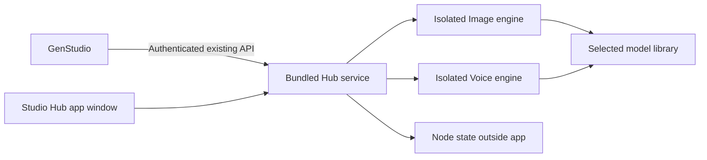

# Standalone Studio app: design and feasibility plan

Date: 2026-09-10. Status: accepted direction; milestone 1 implementation authorized and in progress. See `qualification/voice-runtime.md` for measured results and remaining acceptance checks.

## Decision

Develop one independent `Studio Hub.app` for new Apple Silicon nodes. Package the existing Hub, Image, and Voice services behind one application window, with isolated engine processes and dependencies. Leave all installed Pinokio nodes and their maintenance flow intact. Adopt the standalone app only after a real clean-machine pilot passes.

Hub + Image + Voice is the proposed initial scope, pending any owner correction. The working folder and app name are provisional. No further owner decision blocks planning or a later approved local feasibility build.

The minimum compatibility target is **macOS 14 Sonoma**, with testing on newer supported macOS releases as well. MLX documents macOS 14+ Apple Silicon support, and MLX 0.31.2 has macOS 14 arm64 wheels. This does not certify every engine, native dependency, or model on Sonoma. The exact oldest supported release must be determined by the assembled app and physical-machine tests. Do not lower a binary's deployment metadata to disguise a newer OS requirement. [MLX installation](https://ml-explore.github.io/mlx/build/html/install.html), [MLX wheel metadata](https://pypi.org/pypi/mlx/0.31.2/json), [Metal wheel metadata](https://pypi.org/pypi/mlx-metal/0.31.2/json).

## Boundaries

| Area | Proposed first release |
|---|---|
| Users | New fleet machines; no automatic migration of installed nodes |
| Hardware | Apple Silicon; each model still has its own memory requirements |
| Studios | Hub, Image, Voice; retain distinct runtimes where dependencies differ |
| Installation | Copy an app containing tested runtimes and native tools; no Pinokio, Homebrew, system Python, or developer toolchain required on the node |
| Models | Import or download complete, validated model packages separately |
| GenStudio | Existing authenticated generation workflow, verified against packaged runtime identity and mixed fleet behavior |
| Updates | App replacement for the pilot; no Git pull or package installation on nodes |
| Excluded | Intel, Windows/Linux, old-node migration, Chat/Music/Video implementation, UI redesign, model conversion promises, public App Store submission |

An external SSD is useful for large model libraries and offline transfers. It does not solve incompatible native binaries or insufficient unified memory. Package size and RAM recommendations will come from measurements, not estimates presented as requirements.

## Architecture



Use a thin native macOS shell with the existing web UI as the first packaging candidate. Prove a bundled Python worker before building the window; do not rewrite the studios in Swift or MLX merely to make an app. Hub remains the scheduler. Separate environments prevent incompatible dependency sets from being forced into one Python environment. Reuse existing resource limits; separate processes do not create additional physical GPU capacity.

Proposed bundle layout:

```text
Studio Hub.app/Contents/
  MacOS/StudioHub
  Resources/
    hub/                 # adopted tracked source and built UI
    image/
    voice/
    runtimes/            # isolated relocatable runtimes
    tools/               # required native executables, e.g. FFmpeg
    release-manifest.json
    licenses/
```

The exact runtime packaging method is a feasibility result. First test a relocatable Python environment prepared from locked dependencies, including wheels built on the build machine for source-only packages such as pyopenjtalk. Do not copy an active conda environment as though it were portable. If relocation requires modifying signed executable files at first launch, reject that method for the final app and evaluate a frozen worker executable. Record only the successful method as the production path. [Conda relocation constraints](https://conda.github.io/conda-pack/), [PyInstaller platform constraints](https://pyinstaller.org/en/stable/usage.html).

All executable code and libraries in the shipped bundle are immutable. Store settings, node identity, credentials, queues, outputs and logs in per-user application support locations. Let the owner choose the model library, including an external SSD. A missing volume must produce a clear unavailable state; never silently create a replacement cache or redownload the library elsewhere. Model import validates configuration, tokenizers, companion files, revisions and checksums as required by that model, not just one weights file.

Keep engines on loopback and expose only the authenticated fleet surface through the existing enrollment/network model. Preserve authentication, idempotency, cancellation semantics, output verification, capacity accounting and owner-controlled model exposure. A packaged runtime must be freshly qualified; prior runtime/model audits are reference evidence, not automatic approval of a changed artifact.

Window close may leave the node running with a visible status/menu item. Explicit Quit must drain or clearly handle active jobs without silently replaying them. Login startup is optional and uses native macOS service management after the foreground workflow works. The pilot requires a logged-in user; boot-before-login operation is separate scope. [Apple service management](https://developer.apple.com/documentation/servicemanagement/smappservice).

## Reuse and required adaptations

Source baselines are pinned in `research/source-checkouts.json`: Hub 2.21.3, Image 1.32.1, Voice 2.7.2. Adopt source into the new project's lifecycle at explicit commits. Record local changes so later upstream fixes can be selectively incorporated without linking production to the old working directories.

| Existing assumption | Standalone adaptation |
|---|---|
| `conda_env/bin/python`, Pinokio home and `pterm` process control | Bundle-relative interpreter and app-owned process lifecycle |
| Settings, voice files and generated outputs beside source | Explicit writable state and model paths outside the signed bundle |
| Sibling repository discovery | Explicit locations of bundled components; stable node identity outside bundle |
| Git-based updater and commit inspection | Truthful packaged release identity with component commits and runtime artifact hashes |
| Existing model qualification | Rerun relevant checks against the new runtime and record exact evidence |
| Three dependency trees | Keep necessary isolation; deduplicate only after proving compatibility |

Graphify located Voice's updater/storage dependencies; current source confirmed the assumptions in `auto_update.py`, `settings.py`, `voices.py`, `generation.py`, `cache.py` and `main.py`. The graph covers Voice only, and some recorded locations are stale. A separate source-based Hub contract inventory accompanies this plan.

GenStudio generation endpoints may remain compatible while maintenance endpoints differ. Do not fake a `.git` checkout, report a packaged app as Git-managed, bypass exact-runtime checks, or route legacy nodes to an app updater. The first integration proof must establish whether the current controller accepts the packaged identity. If it needs a contract change outside this project, record the smallest additive change and its separate scope before implementation there. The current release validator fixes three upstream repository identities; a locally adapted standalone component cannot truthfully use its upstream commit as its complete runtime identity. Record the standalone implementation revision and artifact hash as well as upstream provenance. See the [source-linked Hub inventory](../research/hub-contract-inventory.md).

The application's standalone packaging is separate from Hub's internal `standalone` role. A site connected to GenStudio needs the appropriate controller setup; other nodes join it as agents. Preserve these existing roles and enrollment flows rather than making every new machine a controller. The pilot's node/site assignment is selected before enrollment.

## Milestones and acceptance evidence

### 1. Prove a relocatable Voice runtime

Deliver a disposable local bundle and `qualification/voice-runtime.md`, without changing any running node. Use Voice first because it includes the native dependency failure that motivated this project.

1. Inventory pinned Python and native requirements, dynamic libraries, external commands, model files, writable locations and redistribution licenses. Save `research/runtime-inventory.md` and `research/licenses.md`.
2. Adopt tracked Voice source from the recorded commit into `components/voice`; exclude credentials, environments, caches and outputs. Record the source identity and adoption delta.
3. Build an arm64 runtime from pinned inputs targeting Sonoma. Select macOS 14-compatible MLX/Metal wheels explicitly; audit every bundled Mach-O binary and its linked libraries. Produce `packaging/voice-runtime/` scripts and a dependency/hash manifest. Do not resolve packages opportunistically on a node.
4. Adapt only the paths and process launch assumptions needed to run this worker from the bundle. Add focused tests for external writable paths and bundle-relative executable resolution; retain existing generation checks.
5. Run the worker from two different paths, including one containing spaces, using a fresh account with no inherited development PATH, Pinokio, Homebrew or user Python packages. Verify the bundle remains unchanged after launch and a generated job.
6. Import a complete Qwen 0.6B model package from the existing catalog at an exact recorded revision. Generate and validate audio with network unavailable after import. Run transcription with the existing Whisper implementation and record its exact model and revision. These are pilot models, not authorization to expose them commercially.
7. Repeat on a clean physical Apple Silicon Sonoma machine without Xcode/Command Line Tools. Capture OS, hardware, memory, startup duration, job duration, peak memory, output checksums, imports and native dependency evidence. Repeat the same artifact on a newer OS.

Pass: successful audio and transcription, no node-side dependency installation/source builds, no development-path dependencies, no writes inside the bundle, no unexpected network dependency after complete model import, and evidence on Sonoma and a newer OS. Metal's normal runtime kernel compilation is not the prohibited dependency build.

Fail: identify the exact blocking package or behavior. Try one narrowly justified packaging correction. If Sonoma cannot support the selected engine stack without a major rewrite, bring back the measured choice: raise the OS floor or reduce the supported engine/model set. Do not build a universal compatibility framework.

### 2. Package Hub and Image, then prove GenStudio connectivity

Adopt Hub/Image tracked source; build isolated runtimes and existing frontends. Replace standalone-only discovery, lifecycle and data paths. Create a truthful release manifest and adapt runtime reporting. Preserve model exposure controls and physical capacity limits.

Use the existing Image candidate `AITRADER/FLUX2-klein-4B-mlx-4bit`, revision `7fd24828501390b67a92c8b66d2fc5a707d0ba1a`, for the initial 1K text-to-image check. Requalify it on the packaged runtime; the existing README's qualification is not proof for this app. Test larger workloads only after this baseline passes.

Pass evidence: authenticated health/catalog discovery; fresh test-node enrollment; exact runtime/model identities; one image, one speech and one transcription request through the GenStudio integration boundary; status and output retrieval; invalid authentication rejection; cancellation and duplicate-request handling; unavailable model/runtime behavior; appropriate shared capacity reporting. Run against a local test harness first. A live GenStudio/node pilot needs explicit enrollment/deployment authority and test credentials provided through an appropriate secure mechanism.

Exercise a mixed-fleet fixture containing a legacy Pinokio node and a packaged node. Generation routing may see both; maintenance targets only the correct installation type. If current GenStudio or Hub cannot represent this safely, report that blocker before changing another repository.

### 3. Add the app shell and model setup

Build the minimal app window around the existing UI, engine startup/status, model import/download, model location selection and readable failure logs. Preserve existing task semantics. Test Quit, startup failure, occupied ports, duplicate launch, process crashes, disk full, missing SSD, interrupted model import and restart recovery. Never stop an unrelated Pinokio service to claim a port.

Pass: a fresh user can copy the app, open it, select/import models and complete a local job without a terminal. Moving/replacing the app retains node state and model location. A failed startup remains diagnosable.

### 4. Qualify distribution and a controlled pilot

Measure bundle size and hardware requirements. Build a signed, notarized distribution artifact when signing access and submission authority are available. Sign all executable components appropriately and test the downloaded/quarantined artifact on clean machines; do not require globally disabling Gatekeeper. [Apple direct distribution](https://developer.apple.com/documentation/xcode/distributing-your-app-for-beta-testing-and-releases).

Start with manual app replacement while idle; retain the prior app artifact and avoid irreversible state migrations so rollback remains testable. No custom automatic updater is needed for the first pilot. Do not advertise `managed_exact_commit` support before the full behavior is implemented and verified. If GenStudio's existing admission flow requires that capability, manual update support alone is insufficient for fleet adoption: complete the packaged release integration first or report the blocked pilot. Later fleet-managed updates must use the maintenance contract with an explicit packaged release implementation.

Pilot on new nodes only. Require completed generation/transcription/image tests, restart recovery, signed artifact launch, external model storage behavior, authenticated GenStudio operation, and a successful app replacement/rollback preserving identity and data. Observe a full agreed workload cycle before recommending adoption. No old-node conversion is part of acceptance.

## Owner input needed later

Nothing else is required to finish this plan. Proposed defaults are one app, three initial studios, Apple Silicon, Sonoma qualification target, separate model storage, foreground operation first and manual pilot updates.

- **Before clean-machine qualification:** identify one available Sonoma Apple Silicon test Mac and a newer-OS test Mac; confirm their memory. Do not downgrade or erase a machine to manufacture a test environment without authorization.
- **Before real fleet integration:** choose a disposable new pilot node/site and authorize enrollment/testing. A mixed-fleet compatibility fixture is read-only/local preparation.
- **Before distribution:** select the final app name/bundle identifier and signing identity; authorize any notarization submission. No secrets belong in this plan.
- **Before adopting the app:** review the qualification evidence and decide whether the supported models/hardware meet the fleet's needs.

## Completion definition for this planning task

The separate folder, source evidence, architectural boundaries, staged implementation work and concrete pass/fail checks exist and agree with the owner's direction. This does not mean an app has been built, dependencies are portable, every model supports Sonoma, or GenStudio integration has passed. The owner authorized milestone 1 implementation on 2026-09-10. Later milestones remain gated by its qualification results.
