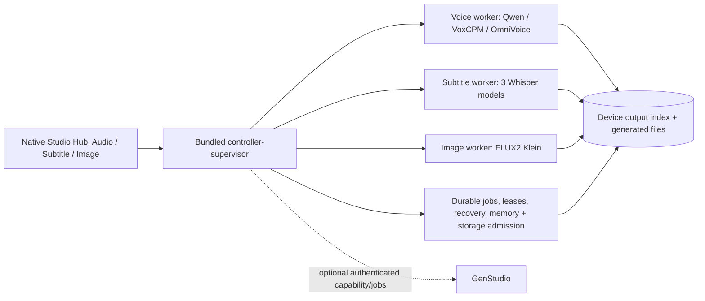

# Rescope inventory: bundled Hub control and per-device output storage

Date: 2026-09-15  
Scope: read-only plan input for `studiohub-standalone` at `29d0baa`, using Hub
source `/build/pinokio/api/studiohub-mac` at `06e893e` (main), plus
the already-adopted Voice source. No service, credential, source checkout, or
planning record was changed.

**Reading key.** Statements under **Observed source** describe code inspected at
the commits above. Statements under **Proposed first-release plan**, including
new interfaces and acceptance gates, are recommendations for the owner-approved
rescope; they are not claims that the source already implements them.

## Confirmed product boundary

The first release bundles Hub control inside the native application. It is the
local controller and scheduler for the app-owned worker processes; it is not an
optional legacy-Hub integration. Image starts with **ImageFLUX2klein**
(`AITRADER/FLUX2-klein-4B-mlx-4bit` at the plan-pinned revision). Voice is
bounded to the Qwen, VoxCPM, and OmniVoice work approved by qualification.
Subtitle Studio is a separate native creation workspace backed by the Voice
runtime distribution, rather than a TTS control hidden in Audio. It has an
independent Subtitle backend, process, job lifecycle, recovery state and output
records. The exact immutable speech runtime distribution may be shared between
the Voice and Subtitle worker packages only after it is qualified for that use.

External GenStudio authority remains unchanged and optional: when enabled, the
bundled local controller implements the existing authenticated site boundary;
it does not take global job ownership. The existing contract explicitly assigns
global authority to GenStudio and local scheduling to the Hub
([CAPABILITY_CONTRACT.md:73](/build/pinokio/api/studiohub-mac/CAPABILITY_CONTRACT.md:73)).

Every setup default is editable **per device**. This includes the generated-file
limit/retention, model location, foreground/login startup preference, local
operation, and the selected connection role. Security, trust, integrity, and
recovery invariants are not preference switches: loopback-only workers, private
credentials, exact model/runtime evidence, lease/admission requirements,
protected-output rules, checksum verification, and no replay of uncertain work
remain mandatory.

Each device has an editable generated-file policy:

| Field | Required first-release behavior |
| --- | --- |
| `max_gb` | Default **50 GB**; editable per device, so 256 GB, 512 GB, and 1 TB Macs may choose different limits. |
| `retention_days` | Default **30** days after generation. |
| Rule | Delete a reclaimable generated file when either condition is met: age is over 30 days, or total generated-file usage is above the device limit. |
| Included | Final generated image, audio, subtitle, and later worker output files plus their output metadata/index. |
| Excluded | Models, runtimes, immutable app bundle, credentials, settings, logs, and active input/import staging. |
| Protected | Active/nonterminal jobs, partial outputs, and a completed artifact whose required local or external transfer acknowledgement is absent. |
| Insufficient relief | Keep protected results; block new generation admission with an actionable storage condition. Do not silently delete protected output. |

The policy must be on the local device, never an account-wide or fleet-wide
limit. An authenticated owner using the controller may read and change the
selected device's own policy through a device-scoped settings action. The
controller must record the actor, device, old/new values, and result; a change
to one device never changes another device's policy.

## What is reusable

### Observed source: Hub controller, scheduling, recovery, and authority

1. The Hub lifecycle initializes a durable SQLite ledger, restores broker and
   subtitle batches, starts dispatch, memory control, automatic recovery, and
   fleet storage, then stops them in reverse at shutdown
   ([main.py:562](/build/pinokio/api/studiohub-mac/app/backend/main.py:562)).
   Reuse this sequence behind the native app-owned supervisor, replacing
   Pinokio discovery and launchd sibling assumptions.
2. The broker already grants one shared physical-machine slot across workers,
   has maintenance/drain state, preserves leases, and uses model-specific RAM
   admission. The capability contract explicitly says Image, Voice, and Chat
   on one Mac share one physical slot
   ([CAPABILITY_CONTRACT.md:105](/build/pinokio/api/studiohub-mac/CAPABILITY_CONTRACT.md:105)).
3. `memory_admission.py` already supports Image, Voice, Transcription, Music,
   and Video and carries a measured default for FLUX2 Klein: 8 GB total and
   2 GB free on an Apple-Silicon Mac
   ([memory_admission.py:21](/build/pinokio/api/studiohub-mac/app/backend/memory_admission.py:21),
   [memory_admission.py:31](/build/pinokio/api/studiohub-mac/app/backend/memory_admission.py:31)).
   For this release, retain the FLUX2 Klein rule and make Qwen/VoxCPM/OmniVoice
   and the selected Whisper model explicit effective-policy records after their
   packaged qualification; no new unmeasured hard-coded model table is needed.
4. `AutomaticRecoveryState` is conservative: it watches exact local Image and
   Voice job state, requires continuous observation plus meaningful stage
   evidence, and turns interrupted recovery into `manual_action_required`
   ([automatic_recovery.py:40](/build/pinokio/api/studiohub-mac/app/backend/automatic_recovery.py:40),
   [automatic_recovery.py:91](/build/pinokio/api/studiohub-mac/app/backend/automatic_recovery.py:91)).
   This is the correct recovery posture for a packaged app. Subtitle jobs need
   equivalent durable-state treatment before automatic retry is enabled.
5. Worker outputs are already exposed only through stable Hub-relative
   artifact URLs, not worker paths ([broker.py:1391](/build/pinokio/api/studiohub-mac/app/backend/broker.py:1391)).
   The Hub persists terminal evidence including byte count, SHA-256, model and
   runtime revisions ([broker.py:1398](/build/pinokio/api/studiohub-mac/app/backend/broker.py:1398)).
   This is the output-index shape to retain.
6. Existing output-transfer acknowledgement is exactly the needed protection
   primitive: `POST /api/hub/jobs/{batch_id}/items/{item_index}/ack` only marks
   `receipt_acked_at` after the worker accepts the acknowledgement
   ([main.py:2924](/build/pinokio/api/studiohub-mac/app/backend/main.py:2924)).
   The bundled controller should record the acknowledgement in the unified
   output index, and reclaim only after it where an acknowledgement is required.

### Observed source: output cleanup and model protection

1. Voice already performs age-first, then oldest-terminal cleanup; it excludes
   queued/running/cancel-requested jobs ([storage_policy.py:122](/build/Projects/studiohub-standalone/components/voice/app/backend/storage_policy.py:122),
   [storage_policy.py:143](/build/Projects/studiohub-standalone/components/voice/app/backend/storage_policy.py:143)).
   Reuse its worker-facing cleanup semantics, but drive candidate eligibility
   from the bundled controller's common index rather than per-worker output
   directories.
2. Hub `job_storage` serializes cleanup, expires files first, and then removes
   oldest terminal subtitle files until under budget; active subtitle work is
   explicitly ineligible ([job_storage.py:116](/build/pinokio/api/studiohub-mac/app/backend/job_storage.py:116)).
   Its present scope is only Hub-local subtitle spools, however
   ([job_storage.py:1](/build/pinokio/api/studiohub-mac/app/backend/job_storage.py:1)).
3. `fleet_storage` already aggregates worker status, applies a policy through
   protected worker APIs, and attempts largest reclaimable store first
   ([fleet_storage.py:177](/build/pinokio/api/studiohub-mac/app/backend/fleet_storage.py:177)).
   It defaults to 80 GB and has a narrow retention-choice set, so it cannot be
   copied unchanged for the new 50 GB / arbitrary per-device policy
   ([fleet_storage.py:21](/build/pinokio/api/studiohub-mac/app/backend/fleet_storage.py:21)).
4. Voice model storage distinguishes model snapshots and required companion
   repositories, marking removal unavailable if an installed model needs the
   companion ([model_storage.py:101](/build/Projects/studiohub-standalone/components/voice/app/backend/model_storage.py:101),
   [model_storage.py:248](/build/Projects/studiohub-standalone/components/voice/app/backend/model_storage.py:248)).
   Models therefore stay entirely outside output quota/reclaim paths.

### Observed source: native lifecycle already present

The native shell already supplies the correct starting point for a bundled
controller:

- `ShellConfiguration` keeps data and model directories outside the application
  and retains an unavailable external model volume as a visible recovery state
  ([ShellCore.swift:47](/build/Projects/studiohub-standalone/native/ShellCore.swift:47)).
- It uses a private single-instance data-directory lock
  ([ShellCore.swift:136](/build/Projects/studiohub-standalone/native/ShellCore.swift:136)).
- `StudioController` starts an app-bundled loopback worker with a sanitized
  environment, private log, ready-file/PID validation, and process termination
  handling ([StudioHub.swift:65](/build/Projects/studiohub-standalone/native/StudioHub.swift:65)).
- `SMAppService.mainApp` is already the native login-startup integration point
  ([StudioHub.swift:18](/build/Projects/studiohub-standalone/native/StudioHub.swift:18)).

### Observed source: roles, connection, and token evidence

`control_plane.py` already defines three bounded roles: `standalone`,
`controller`, and `agent` ([control_plane.py:26](/build/pinokio/api/studiohub-mac/app/backend/control_plane.py:26)).
They map cleanly to this app:

| Per-device role | Local behavior | Optional connection behavior |
| --- | --- | --- |
| `standalone` (default) | The bundled controller schedules this Mac's workers and works without any network setup. | No remote authority or credential is required. |
| `controller` | Same local controller plus the durable site identity that may expose capability/job endpoints to GenStudio. | The owner can explicitly reveal/copy/rotate the connection token and enroll the device later. Local SQLite remains authoritative. |
| `agent` / worker | Executes jobs from its selected controller and never accepts customer submissions. | A private controller address and enrolment credential are required; agent mode must retain durable, actionable `unreachable`, `token_rejected`, and site-identity mismatch states. |

Existing `accepts_customer_jobs()` already rejects customer submission in agent
mode ([control_plane.py:205](/build/pinokio/api/studiohub-mac/app/backend/control_plane.py:205)).
Do not create a new fourth "remote override" mode. A device remote override is
the persisted `parent_controller_url` for `agent`, validated as a credential-free
private address. Failed connection/identity/auth checks become durable
connection records visible in Settings/Connections; the app remains usable for
local jobs only when the selected role permits it.

The current Hub implementation stores Hub/fleet tokens in owner-only (`0600`)
data files: Hub-token creation/reuse is in
[`auth.py:161`](/build/pinokio/api/studiohub-mac/app/backend/auth.py:161),
and fleet-token rotation invalidates cached peer authentication in
[`peers.py:81`](/build/pinokio/api/studiohub-mac/app/backend/peers.py:81).
It does **not** currently use Keychain. The first release should preserve the
tested owner-only `0600` secret storage and scope/reveal discipline. Never place
a token in preferences, log text, error payload, URL/query string, model
metadata, or the app bundle.

The token UI must appear only in Connections/Settings while the device is in
controller mode:

- Status shows only `not configured`, `stored`, or a masked fingerprint such
  as the final six characters; no ordinary status/list/capability response
  contains the secret.
- **Reveal** and **Copy** require current owner-scoped access. Copy is a direct
  explicit action, not an extra confirmation flow; it writes once to the system
  clipboard and reports success without echoing the token.
- **Rotate** atomically creates and persists a new secret in the same protected
  store, invalidates only that secret scope's cached authentication, and gives
  the operator durable affected-connection status. It must never silently
  propagate a new secret to a device whose identity has not been verified.

The older Hub's `GET /api/hub/fleet` follows the right read scope: it reports
`fleet_token_set` and reveals only to loopback or a signed-in owner
([main.py:4351](/build/pinokio/api/studiohub-mac/app/backend/main.py:4351)).
Permanent agent-enrolment codes similarly return no code unless an explicitly
authorized caller asks for it ([enrollment.py:205](/build/pinokio/api/studiohub-mac/app/backend/enrollment.py:205)).
Reuse those authorization boundaries, not the older file storage mechanism.

## Proposed first-release plan: gaps that must be planned, not inherited blindly

| Gap | Why existing code is insufficient | Smallest required adaptation |
| --- | --- | --- |
| One device-wide quota | Hub fleet policy aggregates separate worker reports; Voice and Hub clean independently. Neither represents all local app outputs as one protected set. | Add one bundled-controller SQLite `output_records` index and one serialized reclaimer. Workers report finalization, state and acknowledgements to it. |
| Admission after unreclaimable limit | Existing cleanup reports `over_limit` but dispatch does not make storage relief a pre-dispatch hard gate. | Add `storage_admission` before a lease/job starts: reclaim eligible outputs; admit only if predicted/available space is safe; otherwise return stable `OUTPUT_STORAGE_BLOCKED` with protected-byte and largest-reclaimable diagnostics. |
| Correct age source | Voice currently uses output-file mtime. Copy/move/import can change mtime. | Store immutable `generated_at` when finalization atomically promotes the worker output. Use it for the 30-day rule. |
| Transfer protection | Hub has acknowledgement for routed worker artifacts, but local native UI saves/downloads have no common ack record. | Record `retention_state`: `not_required`, `pending_transfer`, `acknowledged`, or `local_only`. Only the latter two may be reclaimed once terminal. |
| Subtitle separation | Current Voice source deliberately keeps STT in the same server and shared MLX lock, while the product requires an independent Subtitle backend/job lifecycle/process. | Build an independent Subtitle worker and durable subtitle jobs/recovery/output records. It may share an exact immutable runtime distribution with Voice after qualification, but is not a Voice-process route. Hub shared-node admission prevents concurrent heavy model loading. |
| Bounded Voice/subtitle scope | Current Voice catalog wires many families. | Package and publish only qualified Qwen, VoxCPM, OmniVoice, and the initial three qualified Whisper models. Treat others as unavailable, not hidden compatibility. |
| Image worker | No Image runtime has been adopted/qualified in this standalone snapshot. | Isolated Image worker with its own immutable runtime and `ImageFLUX2klein` initial catalog entry; it must use the same controller job/output protocol. |
| Auto start semantics | Existing Hub sibling launchd starts multiple fixed-port services; copying that topology would conflict with the standalone boundary. | Start the bundled controller on foreground app launch. Optional login start registers the native app only after foreground start/quit/restart proof. The controller starts required workers lazily and binds loopback only. |

## Proposed first-release architecture

**Service versus UI:** Audio and Subtitle Studio are different native
workspaces, drafts, results and job filters, backed by independent Voice and
Subtitle processes/job lifecycles. The current source's same-process shared MLX
lock is only observed legacy behavior
([transcription.py:21](/build/Projects/studiohub-standalone/components/voice/app/backend/transcription.py:21));
it is not the final architecture. The Hub controller's shared-node lease and
memory/storage admission is the final cross-worker safety gate. Image remains a
separate service/runtime. No worker bypasses controller admission for a native
UI request.

### Minimal worker/controller interface

Do not add a generic plugin protocol. Use one private loopback contract for the
two first-release workers:

| Direction | Contract | Required fields |
| --- | --- | --- |
| Controller → worker | `POST /private/jobs` | `job_id`, `operation`, `model_id`, immutable `model_revision`, allowlisted `params`, `lease_id`, `output_token` |
| Worker → controller | `POST /private/jobs/{job_id}/state` | `state` (`queued`, `running`, `done`, `error`, `cancelled`, `uncertain`), monotonic `observed_at`, progress, resource evidence |
| Worker → controller | `POST /private/outputs/finalize` | `job_id`, `output_id`, `path` or controller-owned relative locator, `generated_at`, bytes, SHA-256, media type, model/runtime revision, `retention_state` |
| Receiver/controller → worker | `POST /private/outputs/{output_id}/ack` | durable acknowledgement time and receiver identity; idempotent |
| Controller → worker | `POST /private/storage/reclaim` | `candidate_output_ids` only; worker refuses active, partial, missing, or unacknowledged protected records |
| Controller → UI | native local API / workspace store | job summaries, admission reason, reclaimable/protected bytes, model state, logs link |

The native controller's optional external endpoint needs a separate
machine-to-machine token scope. Worker private tokens are generated per local
launch and never appear in UI. Keep the controller/GenStudio connection token
separate from a fleet-worker token; rotating one does not revoke unrelated
queued/running jobs or invalidate the other scope. The controller's GenStudio
connection token is usable only for the declared capability/job endpoints and header authentication
(`Authorization: Bearer` or `X-Hub-Token`), matching the existing contract
([CAPABILITY_CONTRACT.md:16](/build/pinokio/api/studiohub-mac/CAPABILITY_CONTRACT.md:16)).
Browser cookies, URL values, copied Hub dashboard tokens, and model-download
tokens are not substitutes for it.

The controller owns the index and eligibility decision. A worker owns deletion
of its files only after the controller supplies exact eligible IDs. This avoids
cross-engine directory walking and lets future output roots be added without
accidentally treating models, inputs, or logs as disposable.

Suggested `output_records` fields: `output_id`, `job_id`, `worker`,
`operation`, `state`, `relative_path`, `generated_at`, `bytes`, `sha256`,
`media_type`, `model_id`, `model_revision`, `runtime_revision`,
`retention_state`, `receipt_acked_at`, `deleted_at`, and `delete_reason`.
All paths must be resolved under a declared worker output root before a delete;
the index must never retain an arbitrary client path.

## Proposed storage admission and reclaim algorithm

1. Before a controller assigns a new heavy job, serialize a storage check with
   finalization/reclaim. Read current usage from the output index plus a bounded
   reconciliation of declared output roots.
2. Reclaim records older than `generated_at + retention_days` that are terminal
   and retention-safe. Then reclaim oldest retention-safe terminal records until
   usage is at or below `max_gb`.
3. Recheck actual usage and reserve a conservative per-operation output estimate
   for the job. The initial estimate is a worker/model manifest field, updated
   only by measured qualification. Do not guess a large global reserve.
4. If space cannot be made safe without touching protected records, do not grant
   the lease. Return `OUTPUT_STORAGE_BLOCKED`, with `used_bytes`, `max_bytes`,
   `protected_bytes`, `reclaimable_bytes`, and an operator action. Keep current
   jobs and pending transfers intact.
5. On finalization, atomic-publish the output, checksum it, persist the terminal
   record, release memory according to worker policy, then run the same cleanup.
   A worker that cannot persist its final record returns an uncertain/error state
   rather than silently dropping retention evidence.
6. Run one background sweep after a safe startup delay and periodically while
   the app is running. Existing Voice behavior uses a 60-second delay then an
   hourly pass ([storage_policy.py:186](/build/Projects/studiohub-standalone/components/voice/app/backend/storage_policy.py:186)); retain that cadence unless measurement shows a need to change it. Foreground admission remains authoritative, so a delayed sweep never admits an unsafe job.

## Proposed acceptance gates for implementing agents

### Controller and lifecycle

- One app instance holds the data-directory lock; a second instance directs the
  user to the running app without spawning another controller or worker.
- Foreground launch starts the bundled controller and returns a validated
  `127.0.0.1` ready endpoint. Occupied-port, malformed ready file, worker crash,
  and missing model volume all remain diagnosable in the private log.
- Window close may retain the chosen local service/menu-item behavior; explicit
  Quit drains/cancels according to the durable job state and never replays an
  uncertain job. Existing Voice restart converts in-flight jobs to `uncertain`
  rather than resuming them ([generation.py:4218](/build/Projects/studiohub-standalone/components/voice/app/backend/generation.py:4218)).
- Login start is opt-in, uses `SMAppService.mainApp`, and is tested only after
  manual launch/quit/restart works. It starts the app/controller, not five
  legacy launchd services.
- Settings prove each role separately: default standalone survives restart;
  controller token status is masked after restart; agent rejects customer jobs;
  an invalid/private-unreachable controller override persists a durable error
  without deleting the last known local job/output evidence. Role changes that
  would invalidate active leases are refused until jobs drain or are explicitly
  cancelled through the durable job flow.

### Workspaces and capacity

- Audio UI and Subtitle Studio UI retain separate drafts and selected models;
  Subtitle Studio produces text, SRT, and VTT through its independent worker.
  Hub shared-node admission permits only one heavy local model execution at a
  time across Voice, Subtitle, and Image.
- Image accepts only the initial FLUX2 Klein model at first release. Voice
  accepts only packaged/qualified Qwen, VoxCPM, OmniVoice models; Subtitle
  accepts only its initial three packaged/qualified Whisper models; unavailable
  catalog models have no dispatch route.
- No worker begins a heavy job without controller lease, runtime/model readiness,
  current memory admission, and storage admission. Image and Voice cannot
  double-count one Mac's physical memory capacity.

### Storage and artifact safety

- Per-device default reads as `max_gb: 50`, `retention_days: 30`; an operator can
  change both independently on separate Macs. Models/runtime bytes do not affect
  either `used_bytes` or reclaim candidates.
- A 31-day-old terminal acknowledged output is deleted on sweep. A newer output
  is deleted only when necessary for cap relief, oldest eligible first.
- Queued, running, cancel-requested, partial, uncertain, and unacknowledged
  transfer outputs are never candidates. A failed/partial transfer remains
  protected until acknowledged or explicitly resolved by the normal job-recovery
  flow.
- If protected output keeps usage above the limit, new generation returns
  `OUTPUT_STORAGE_BLOCKED`; existing jobs are untouched and no model, log,
  credential, setting, input reference, or runtime file is removed.
- Deletion rechecks that the indexed file is inside the owning worker's declared
  output root, is terminal in both controller and worker state, and has not
  changed from the indexed final evidence. The index records deletion reason.
- Restart reconciliation preserves terminal records and converts incomplete
  finalization into attention/uncertain, rather than orphan deletion.

### Optional external contract

- Keep `/api/hub/capabilities` authentication headers and schema/version checks
  unchanged ([CAPABILITY_CONTRACT.md:16](/build/pinokio/api/studiohub-mac/CAPABILITY_CONTRACT.md:16)).
- Token status, connection diagnostics, capability responses, and exported
  support bundles are secret-free. Test local-owner reveal/copy/rotate and a
  remote caller's rejected reveal attempt. Rotate must invalidate the prior
  token only within its scope, preserve unrelated active/queued jobs and the
  separate fleet-worker scope, and leave the controller locally operational.
- The bundled controller reports truthful packaged component/runtime identities;
  do not depend on runtime Git. Do not advertise managed exact-commit update
  support unless its full existing maintenance behavior is implemented and
  qualified.
- Exercise duplicate delivery, cancellation, stale fencing, artifact checksum,
  acknowledgement retry, and response-loss polling using a local fixture before
  any live GenStudio enrollment. Live enrollment/deployment remains out of
  scope for this plan.

## Exact existing endpoints and fields to preserve or adapt

| Existing path | Reuse decision |
| --- | --- |
| `POST/GET /api/hub/jobs`, `GET /api/hub/jobs/{batch_id}`, `DELETE /api/hub/jobs/{batch_id}` | Reuse the durable job/lease/cancel semantics; adapt controller routing to bundled workers. Current active summary includes `queued`, `retrying`, `running`, `cancel_requested`, and `uncertain` ([main.py:2321](/build/pinokio/api/studiohub-mac/app/backend/main.py:2321)). |
| `GET /api/hub/jobs/{batch_id}/items/{item_index}/artifact` | Preserve stable proxy artifact endpoint and terminal SHA-256/byte evidence ([main.py:2381](/build/pinokio/api/studiohub-mac/app/backend/main.py:2381)). |
| `POST /api/hub/jobs/{batch_id}/items/{item_index}/ack` | Preserve as the external-transfer acknowledgement bridge; map it to `output_records.receipt_acked_at` ([main.py:2924](/build/pinokio/api/studiohub-mac/app/backend/main.py:2924)). |
| `GET/PUT/DELETE /api/hub/memory-admission` | Reuse effective model-memory policy and persisted operator overrides ([main.py:3248](/build/pinokio/api/studiohub-mac/app/backend/main.py:3248)). |
| `GET/PUT/POST /api/hub/storage-policy[/cleanup]` | Replace the current fleet/80-GB behavior with per-device 50-GB output-index policy. Keep name only if maintaining compatibility; expose fields `enabled`, `max_gb`, `retention_days`, `used_bytes`, `protected_bytes`, `reclaimable_bytes`, `over_limit`, and `scope`. |
| `GET/POST /api/hub/job-storage[/cleanup]` | Do not keep as an independent budget. Fold subtitle spool and final subtitle output accounting into the one device policy; retain explicit cleanup action only as a controller call into the common reclaimer. |
| Voice `GET/PUT/POST /api/storage-policy[/cleanup]` | Keep worker-level status/reclaim plumbing during transition, but worker cleanup accepts controller-selected output IDs rather than choosing files on its own. |

## Plan order

1. Adopt Hub scheduling/ledger/recovery sources at `06e893e` into the bundle with
   explicit app-owned roots and no Pinokio/launchd sibling discovery.
2. Define and test the common output index, 50 GB/30-day device policy,
   acknowledgement protection, and storage admission before adding Image.
3. Adapt the existing Voice proof into bounded Qwen/VoxCPM/OmniVoice Audio plus
   separate Subtitle Studio UI/commands while retaining one shared MLX lock.
4. Add the isolated FLUX2 Klein Image worker to the exact same controller
   lease/output protocol, then qualify memory and storage behavior on targeted
   machines.
5. Add optional external capability/job integration only after local controller,
   recovery, output retrieval, acknowledgement and storage gates pass in a
   local fixture.

## Inspection proof

Read-only source evidence was inspected from:

- Hub controller: `app/backend/main.py`, `broker.py`, `memory_admission.py`,
  `automatic_recovery.py`, `job_storage.py`, `fleet_storage.py`, `ledger.py`,
  `registry.py`, and `startup_services.py` at `06e893e`.
- Standalone shell: `native/ShellCore.swift`, `native/StudioHub.swift`, and
  `native/StudioAPI.swift` at standalone `29d0baa`.
- Adopted Voice: `components/voice/app/backend/generation.py`,
  `transcription.py`, `storage_policy.py`, and `model_storage.py`.

No source was edited; this report is the sole task output.

## Additional owner requirements: model packages and location API

The owner added GitHub download plus copy/paste model-folder setup, retained location
membership and generation/statistics data, and address/IP + token connections suitable
for a future standalone GenStudio. The final GenStudio-to-location endpoint is pending
clarification; these sources do not resolve that product choice.

Read-only audit baseline: Hub 06e893e1643bffbcbd162fae122e5a4d0f29e283, clean main.

- [control_plane.py](/build/pinokio/api/studiohub-mac/app/backend/control_plane.py:120): roles standalone/controller/agent, site_id/site_name/controller_id and parent_controller_url. Preserve GenStudio global authority and agent rejection of customer queues.
- [main.py connection setup](/build/pinokio/api/studiohub-mac/app/backend/main.py:1416): setup/check-controller, setup/join and enrollment routes. [enrollment.py](/build/pinokio/api/studiohub-mac/app/backend/enrollment.py:313) validates credential-free HTTP(S) root URLs on private networks. Current enrollment requires a controller peer; changing topology requires an explicit implementation decision.
- [auth.py](/build/pinokio/api/studiohub-mac/app/backend/auth.py:381): service authentication uses Authorization Bearer or X-Hub-Token headers, not cookies/query parameters. Owner-facing access/fleet token reveal remains separately scoped; preserve token storage protections.
- [main.py telemetry](/build/pinokio/api/studiohub-mac/app/backend/main.py:1877): resources, summary and stream expose live machine/studio information. [stats route](/build/pinokio/api/studiohub-mac/app/backend/main.py:3945) uses durable ledger aggregates; metrics resource samples are short-lived and are not durable history.
- [broker.py](/build/pinokio/api/studiohub-mac/app/backend/broker.py:902): retain batch IDs, item indexes, clientRequestId replay/fingerprint and artifact proxy/evidence behavior. Do not expose worker-local paths in customer results.
- [registry.py](/build/pinokio/api/studiohub-mac/app/backend/registry.py:205): current local registry assumes Image/Voice and fixed ports. Subtitle needs explicit registration/capability/ledger integration; copying the old two-modality mapping is insufficient.
- [main.py model routes](/build/pinokio/api/studiohub-mac/app/backend/main.py:1848): catalog and broadcast/download exist. Complete-folder import and configured GitHub packages are planned additions, not existing capabilities.

Preserve the current site-capabilities contract and authenticate its use. Keep stable
site/node IDs separate from editable labels/IPs. Current read-only audit did not change
source, services, credentials or enrolled nodes.
